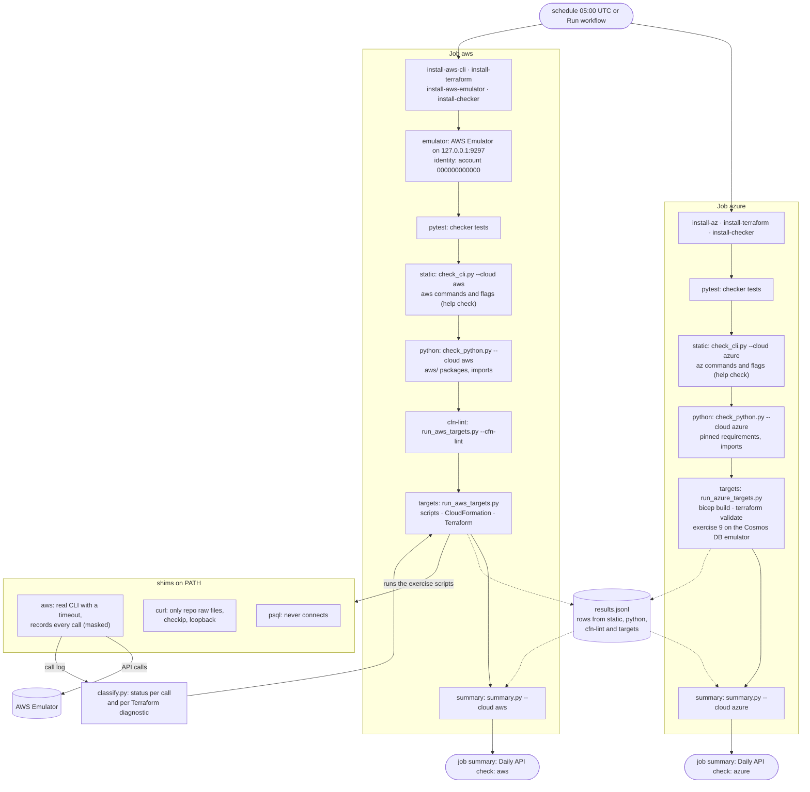

# Daily API check

The checker behind `.github/workflows/cloud-api-check.yml`. Every day at 05:00 UTC (and on demand) it checks that a
student following the exercises today would not hit a changed Azure or AWS API: renamed or removed CLI commands and
flags, retired Bicep API versions, Terraform provider changes, pinned Python packages that no longer install, and AWS
scripts and templates that the AWS API now rejects.

It does **not** deploy anything to a real Azure subscription or AWS account, needs no secret, and does not run on push
or pull requests. A real deployment is still the end-to-end check of an exercise.

## What happens where

Both jobs run on `ubuntu-latest`. Every check step runs even when an earlier one failed (`if: always()`), and the last
step turns the results into the job summary and the job's pass/fail.



The `static`, `python`, `cfn-lint` and `targets` steps write their rows to `$RUNNER_TEMP/api-check/results.jsonl` (the
dotted arrows from the two `targets` steps stand for all of them). Steps that write no rows — installs, `emulator`,
`identity`, `pytest` — reach `summary.py` through the step outcomes the workflow passes in (`STEPS_JSON`): a failed one
becomes an `infrastructure` row. `summary.py` turns all of it into the job summary and fails the job on
`missing-command`, `missing-flag`, `drift` or `infrastructure`.

### Job `azure`

| Step `id` | Runs | Checks |
| --- | --- | --- |
| `install-az`, `install-terraform`, `install-checker` | Microsoft's Azure CLI installer + `az bicep install`, HashiCorp's apt repository, a venv from `requirements.txt` | The latest Azure CLI, Bicep and Terraform, as students get in Cloud Shell |
| `pytest` | `pytest .github/api-check` | The checker's own tests |
| `static` | `check_cli.py --cloud azure` | Every `az …` command and its `--flags` in the readmes and scripts still exist (`az <command> --help`) |
| `python` | `check_python.py --cloud azure` | Each Azure-side `requirements.txt` installs as pinned and every import in the exercise's Python files resolves |
| `targets` | `run_azure_targets.py` | `az bicep build` of exercises 12 and 13 (errors and BCP081 = retired API version); `terraform init` + `validate` of 14, 15, 18; exercise 9's Cosmos DB sample against the Cosmos DB Linux emulator (Docker, `127.0.0.1:8081`) |
| `summary` | `summary.py --cloud azure` | Writes the job summary; fails the job on `missing-command`, `missing-flag`, `drift` or `infrastructure` |

### Job `aws`

| Step `id` | Runs | Checks |
| --- | --- | --- |
| `install-aws-cli`, `install-terraform`, `install-aws-emulator`, `install-checker` | AWS CLI v2 installer, HashiCorp's apt repository, AWS Emulator `LTS/latest` package, the checker venv | The latest AWS CLI and Terraform; the emulator |
| `emulator` | `aws-emulator -p 9297 -t off` | Starts AWS Emulator on `127.0.0.1:9297` (telemetry off) and points the AWS CLI and Terraform at it through its own config, credentials and CA files |
| `identity` | `aws sts get-caller-identity` | The account is the emulator's `000000000000`, so nothing can reach real AWS |
| `pytest` | `pytest .github/api-check` | The checker's own tests |
| `static` | `check_cli.py --cloud aws` | Every `aws …` command and flag in the readmes and scripts still exists (`aws <service> <operation> help`) |
| `python` | `check_python.py --cloud aws` | Each `aws/` folder's packages install (its own `requirements.txt`, or the latest `boto3`) and its imports resolve |
| `cfn-lint` | `run_aws_targets.py --cfn-lint` | The CloudFormation templates of 12 and 13 pass `cfn-lint` (e.g. no deprecated Lambda runtime) |
| `targets` | `run_aws_targets.py` | Runs the exercises' AWS scripts, deploys the CloudFormation templates and applies the Terraform configurations against the emulator (list below) |
| `summary` | `summary.py --cloud aws` | Writes the job summary; fails the job on `missing-command`, `missing-flag`, `drift` or `infrastructure` |

AWS targets (from `targets.yml`): the scripts `aws/aws-*.sh` of exercises 2, 3, 4 (two), 6 (two), 7, 8, 9, 10 and 11;
CloudFormation stacks of 12 and 13; Terraform `aws/` of 14 and 15. Exercise 5's AWS script (Elastic Beanstalk `eb`
CLI) and the EC2 user-data scripts are never run. Each target runs in a copy of its exercise made with `git archive`,
so the repository is never changed; exercise 7's `<your-…>` placeholders are filled in that copy only.

## Files

| File | Role |
| --- | --- |
| `common.py` | Results file (`$RUNNER_TEMP/api-check/results.jsonl`), masking of passwords, keys and tokens, log paths, the `targets.yml` loader, the `rawlog` command the aws shim calls |
| `check_cli.py` | Finds `az`/`aws` commands in Markdown code blocks (Bash and PowerShell) and `.sh` files and checks them against the installed CLI's help; runs the CLI without a shell |
| `check_python.py` | Builds one venv per `requirements.txt` (kept in `$RUNNER_TEMP/api-check/venvs/`) and resolves the imports |
| `run_azure_targets.py` | Bicep, Terraform validate and the Cosmos DB emulator run |
| `run_aws_targets.py` | Safety checks before any AWS call, then the AWS targets with the shims first on `PATH` |
| `classify.py` | Turns the recorded AWS calls, the exercise 9 sample output and Terraform's JSON output into statuses |
| `summary.py` | Job summary tables and the job's exit code |
| `shims/aws` | Stands in for `aws` during the targets step: runs the real CLI with a timeout (120 s, 600 s for `cloudformation deploy`) and records every call (masked) |
| `shims/curl` | Lets scripts reach only this repository's raw files on GitHub, `checkip.amazonaws.com` and loopback; any other address (e.g. one returned by the emulator) is not contacted |
| `shims/psql` | Never connects (the database host comes from the emulator) |
| `targets.yml` | What runs per exercise, plus `skip` and `emulator_gaps` (below) |
| `test_api_check.py`, `fixtures/` | The tests (`pytest .github/api-check`) and their fake CLIs and sample files |
| `requirements.txt` | The checker's own packages (PyYAML, pytest pinned; `cfn-lint` latest) |

## Statuses

| Status | Fails the job | Meaning | What to do |
| --- | --- | --- | --- |
| `ok` | no | Works (counted, not listed) | — |
| `missing-command` | yes | The CLI no longer has this command | Fix the exercise (readme and script, Bash and PowerShell) |
| `missing-flag` | yes | The command no longer accepts this flag (an unambiguous short form of a listed flag counts as accepted) | Fix the exercise |
| `drift` | yes | Bicep, Terraform, a package, a script call or a template fails in a way that is not a known emulator gap; also a Terraform apply that exits non-zero with no reason, and a script or non-waiting call that times out | Find out whether the cloud changed (fix the exercise) or the emulator differs (record a gap) |
| `infrastructure` | yes | The check itself could not run: an install or a workflow step failed, the emulator did not start, a target was never reached, or a script or deploy recorded no `aws` call | Look at the run's log for that step |
| `not-covered` | no | The emulator does not implement the call (HTTP 501), a waiter or deploy never reached its state, or a recorded emulator gap matched | Nothing; the summary lists it every run |
| `consequential` | no | Failed only because an earlier `not-covered` call in the same script (or a resource it depends on in Terraform) failed | Nothing |
| `newly-covered` | no | A recorded emulator gap now works | Remove that entry from `targets.yml` |
| `skipped` | no | Listed under `skip` in `targets.yml` | — |

## targets.yml

- `skip`: commands or flags the help check cannot validate, as `{target: "az foo bar" or "az foo bar --flag",
  reason}`. Empty today.
- `python`: `parent_requirements` (an `aws/` folder that installs its parent exercise's `requirements.txt`, today
  6-paas-iot-mqtt/aws) and `skip_imports` (imports not to resolve, each with a `reason`; empty today).
- `emulator_gaps`: places where AWS Emulator differs from AWS (today: no Canonical Ubuntu SSM parameters, no Fargate
  tasks, no Lambda log group, no `InvokedViaFunctionUrl`, no S3 Control tags). Each entry has the `exercise`, `cloud:
  aws` for the AWS job, a `pattern` on the error and/or a `target` on the call or Terraform address, a `reason`, and
  optionally a `link` to an emulator issue. Real drift is fixed in the exercise, never hidden here.
- `azure`, `aws`: the targets each job runs.

## Run it locally

From the repository root, in a venv:

```bash
pip install -r .github/api-check/requirements.txt
pytest .github/api-check
AZURE_CONFIG_DIR="$(mktemp -d)" python .github/api-check/check_cli.py --cloud azure   # don't touch ~/.azure
python .github/api-check/check_cli.py --cloud aws
python .github/api-check/summary.py --cloud azure
```

Results go to the system temp folder (`$RUNNER_TEMP` on GitHub); `python .github/api-check/common.py reset` clears
them. The AWS targets need AWS Emulator running locally (its Docker image or Linux package) and its connect variables
set, as the workflow's `emulator` step does.

## Safety

- No real cloud credentials exist anywhere in the workflow; the token is read-only (`contents: read`).
- Both emulators are reached on `127.0.0.1` only: the Cosmos DB emulator's port is published on `127.0.0.1`, AWS
  Emulator binds to `127.0.0.1` by default, and the AWS runner refuses to start unless its endpoint is
  `https://127.0.0.1:<port>`.
- Passwords, keys and tokens are masked before anything is written to the results or the summary; script output goes
  to files on the runner, not to the public log.
- Commands found in the readmes are never run through a shell: only their help is read.

## Keeping it running

GitHub pauses scheduled workflows after 60 days without activity in the repository. If the daily runs stop, re-enable
the workflow on the Actions page.
